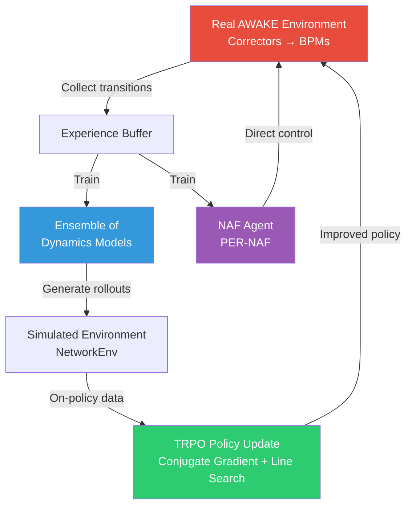
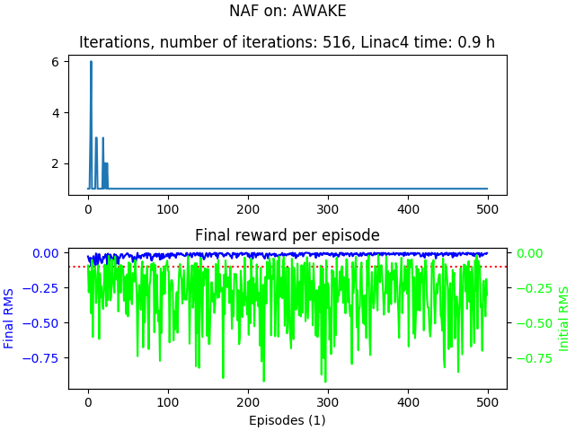
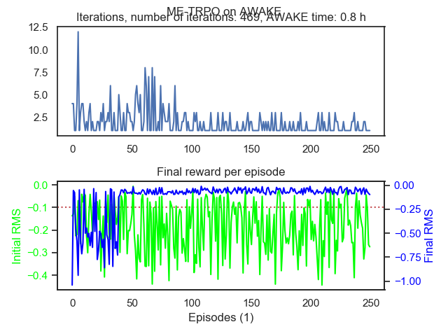

# Model-Based Reinforcement Learning for AWAKE

[](https://www.python.org/downloads/)
[](https://opensource.org/licenses/MIT)
[](https://www.tensorflow.org/)

> **Model-Ensemble Trust Region Policy Optimisation (ME-TRPO)** applied to the electron beam trajectory steering problem at the [CERN AWAKE experiment](https://home.cern/science/accelerators/awake) — a proof-of-principle demonstration of sample-efficient model-based RL on a real particle accelerator.

---

## Overview

This repository implements **Model-Based Reinforcement Learning** algorithms for correcting electron beam trajectories in the AWAKE transfer line (TT43) at CERN. The key idea is to learn an *ensemble of environment models* from limited interaction data and then use these models to generate simulated rollouts for policy improvement via TRPO, dramatically reducing the number of real machine interactions needed.

### Key Features

- **Model-Ensemble TRPO (ME-TRPO)** — Learns an ensemble of neural network dynamics models and uses them for on-policy rollout generation
- **NAF with Prioritised Experience Replay (PER-NAF)** — Normalised Advantage Function for continuous control with prioritised replay
- **ME-MFRL** — Hybrid framework combining model-based rollouts with model-free RL agents (NAF)
- **AWAKE Simulation Environment** — Physics-based simulation of the AWAKE electron beamline using Twiss parameters and response matrices

---

## Architecture



---

## Repository Structure

```
MODEL-BASED-RL/
├── ME-PER-NAF.py                  # ME-TRPO with PER-NAF (original version)
├── Simon_Converging_ME-TRPO.py    # ME-TRPO with convergence improvements
├── Simon_ME-MFRL.py               # ME framework with model-free RL (NAF)
├── basic_spinning_up.py           # Baseline experiments using Spinning Up (TRPO, SAC, TD3)
├── simon_basic_test_script.py     # NAF standalone test on AWAKE
├── history_plot.py                # Plotting training history from pickled data
│
├── simulated_environment.py       # AWAKE sim (incremental action mode)
├── simulated_environment_final.py # AWAKE sim (absolute action mode, final version)
├── new_simulated_environment.py   # AWAKE sim (relative action mode variant)
│
├── Application/
│   ├── twissReader.py             # Twiss parameter parser (MAD-X format)
│   └── electron_tt43.out          # AWAKE TT43 optics data
│
├── pernaf/                        # PER-NAF sub-package (pip-installable)
│   ├── pernaf/
│   │   ├── naf.py                 # NAF agent with PER
│   │   └── utils/                 # Core network, replay buffer, statistics
│   ├── setup.py
│   └── README.md
│
├── NAFon_AWAKE.png                # NAF training results
├── On_the_machine.png             # Real machine deployment results
├── pyproject.toml                 # Project metadata
└── README.md
```

---

## Algorithms

### ME-TRPO (Model-Ensemble Trust Region Policy Optimisation)

The core algorithm follows the [ME-TRPO paper](https://arxiv.org/abs/1802.10592):

1. **Collect** real environment data using the current policy
2. **Train** an ensemble of `N` neural network dynamics models on the collected data
3. **Generate** simulated rollouts by randomly selecting models at each step (for diversity)
4. **Update** the policy using TRPO with GAE on the simulated data
5. Repeat from step 1

### PER-NAF (Prioritised Experience Replay — Normalised Advantage Function)

An off-policy continuous control method based on the [NAF paper](https://arxiv.org/abs/1509.02971), enhanced with [Prioritised Experience Replay](https://arxiv.org/abs/1511.05952) for improved sample efficiency. Available as the standalone [`pernaf` package](https://github.com/MathPhysSim/PER-NAF).

### AWAKE Simulated Environment

The simulation models the AWAKE electron transfer line (TT43) using:
- **Twiss parameters** parsed from MAD-X output files
- **Response matrices** computed from beta functions and phase advances
- **Corrector magnets** (actions) that apply angular kicks to the beam
- **BPM readings** (observations) that measure the resulting trajectory

---

## Getting Started

### Prerequisites

```bash
# Python 3.7+ with TensorFlow 1.x
pip install tensorflow==1.14 numpy gym scipy pandas matplotlib seaborn bayesian-optimization
```

### Installation

```bash
git clone https://github.com/MathPhysSim/MODEL-BASED-RL.git
cd MODEL-BASED-RL
pip install -e .
```

### Running

```bash
# Run ME-TRPO on the AWAKE simulation
python Simon_Converging_ME-TRPO.py

# Run ME-TRPO with NAF as the model-free component
python Simon_ME-MFRL.py

# Run standalone NAF test
python simon_basic_test_script.py

# Run baselines (requires Spinning Up)
python basic_spinning_up.py
```

---

## Results

| NAF on AWAKE Simulation | Deployed on the Real Machine |
|:-:|:-:|
|  |  |

The ME-TRPO approach achieves successful trajectory correction within **~50 real machine interactions** — orders of magnitude fewer than model-free methods which typically require thousands of interactions.

---

## Acknowledgements

- **CERN AWAKE Collaboration** — for providing access to the AWAKE electron beam line
- [ME-TRPO](https://arxiv.org/abs/1802.10592) — Kurutach et al., 2018
- [NAF](https://arxiv.org/abs/1509.02971) — Gu et al., 2016
- [PER](https://arxiv.org/abs/1511.05952) — Schaul et al., 2016
- [Spinning Up in Deep RL](https://spinningup.openai.com/) — OpenAI

---

## License

This project is licensed under the MIT License — see the [LICENSE](pernaf/LICENSE) file for details.